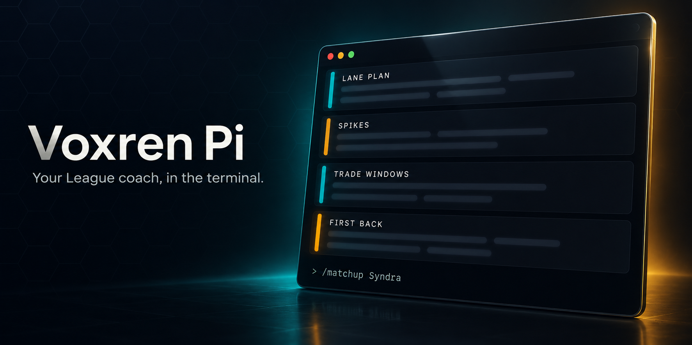
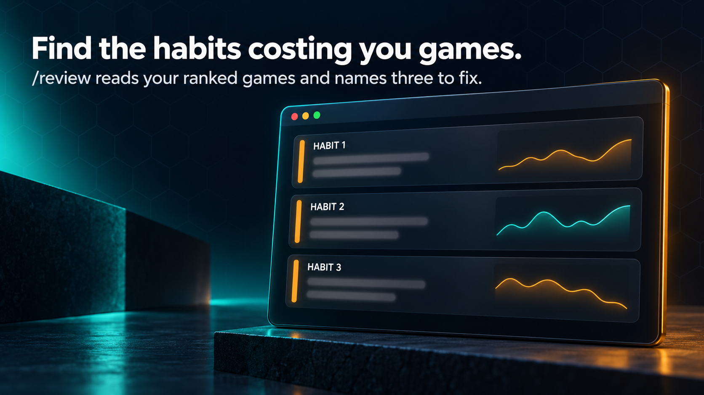
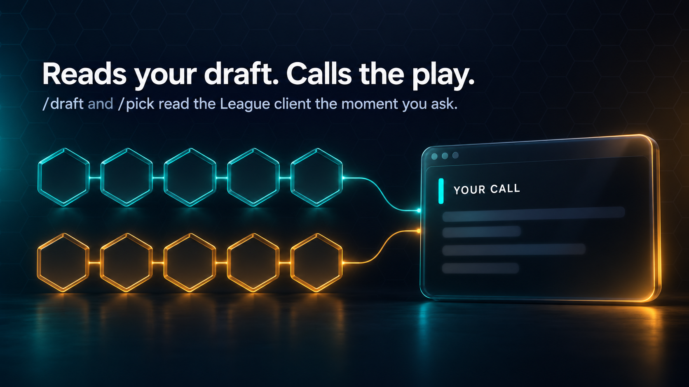
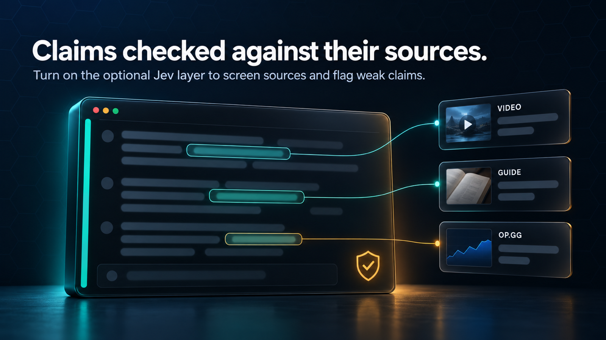

<div align="center">



Ask it a matchup, a build, or what changed this patch. It answers in short rows with the numbers it looked up. Point it at your ranked games and it names the three habits costing you the most, each with a drill and a target for next time.

[](https://github.com/stitts-dev/voxren-pi-public/actions/workflows/test.yml)
[](https://nodejs.org)
[](#install)
[](LICENSE)

</div>

---

## Install

One line. Needs [Node 22.19.0+](https://nodejs.org) and git.

**macOS**

```bash
curl -fsSL https://raw.githubusercontent.com/stitts-dev/voxren-pi-public/main/bin/install.mjs | node
```

**Windows (PowerShell)**

```powershell
irm https://raw.githubusercontent.com/stitts-dev/voxren-pi-public/main/bin/install.mjs | node
```

It clones the repo into `./voxren-pi`, installs [Pi](https://github.com/earendil-works/pi) if it is missing, and puts `coach` on your PATH. Prefer to do it by hand? `git clone https://github.com/stitts-dev/voxren-pi-public.git voxren-pi && cd voxren-pi && npm run setup` is the same thing.

Then:

```bash
coach
```

## First run

1. **Sign in.** The coach runs on GPT through your ChatGPT/Codex plan. Type `/login`, pick "Sign in with an account", then restart `coach`. To use an API key with another provider instead, see [docs/configuration.md](docs/configuration.md).
2. **Add a Riot key** for the game audits. Get a Development key at [developer.riotgames.com](https://developer.riotgames.com), type `/riot-key`, and paste it. It goes into your system key store (the macOS Keychain, or a DPAPI-encrypted file under your local app data on Windows), never `.env` or the repo, and expires every 24 hours.
3. **Optional:** video research (what guide and matchup videos say). Install [`uv`](https://docs.astral.sh/uv/) and the coach starts its research service itself, on Windows, macOS and Linux (see `docs/configuration.md`). Web search for patch notes and written guides needs nothing extra on the ChatGPT/Codex plan. Without the service the header says video research is off and everything else still works.

## What it does

<p align="center">
  
  
</p>

```
/matchup Syndra          lane plan: levels 1 to 6, spikes, trade windows, first back
/build                   build, runes, skill order for the current patch
/review 20               your last 20 ranked games: the three habits to fix, with drills
/review Friend#TAG 10    the same for a friend's account
/otp Name#TAG            a one-trick's build to copy: items with minutes, rune page, skill order
/comp                    reads your champ select or live game and calls the play
```

| Command | Does |
| --- | --- |
| `/review [games] [Name#TAG]` | Audits your last ranked games, or a friend's with a Riot ID (default 10): top three habits, each with a metric to re-measure and a drill |
| `/matchup <enemy>` | Lane plan: levels 1 to 6, spikes, cooldowns, trade windows, runes, first back (`/matchup <mine> vs <enemy>` for another champion) |
| `/build [enemy]` | Build, runes, and skill order for the current patch |
| `/patch [champion]` | What changed this patch and whether it changes how you play |
| `/comp [question]` | Reads the current champ select or live game from the League client and asks for the play |
| `/draft` | The short version for the last seconds of champ select: four calls, then runes and build, from one OP.GG lookup checked by the grounding frame, about 17 s |
| `/pick` | The pick call for your hovered or locked champion: the lane matchup, only the rune and summoner changes this draft calls for, and a dodge row when the draft is bad. One OP.GG lookup |
| `/otp <player>` | A player's recent ranked games on your champion (Riot ID or op.gg link): item order with minutes, full rune page, skill order |
| `/riot-key` | Store, test, or remove the Riot Development key |
| `/config` | Theme (live preview) and default champion, saved to your profile |

Set `VOXREN_COACH_CHAMPION` to your main; commands and prompts follow it, in any role. Leave it unset and the coach reads your champion from the live game or a command's own argument instead. The lane is read from the League client, `VOXREN_COACH_LANE`, or the champion's usual lane. `coach -p "how do I beat Syndra"` asks once and prints the answer; `coach -c` continues the last conversation.

Four themes ship in [`themes/`](themes): tidal (default), hextech, void, signal. Audit charts and item icons draw inline in Kitty, Ghostty, WezTerm, and iTerm2, and fall back to text everywhere else. `coach` opens in its own terminal, WezTerm with the repo's config on Windows and macOS (setup installs it), so the coach looks the same everywhere; `VOXREN_COACH_TERMINAL=here` keeps it where you started it. See [docs/configuration.md](docs/configuration.md#the-coachs-own-terminal).

## Built on Pi, with the coding parts removed

Voxren Pi is one extension for the [Pi](https://github.com/earendil-works/pi) coding agent. No shell, no files, a small fixed set of tools and commands. Every prompt lives in one file, [`coach.yaml`](coach.yaml), so you can read exactly what the model is told.

## How it works


`coach` is a small Node launcher. It loads your keys, then starts Pi with this extension and nothing else. Every network call goes through one gateway. When `TYPESAFE_API_KEY` is set, [Jev](docs/jev.md) grades each prompt to pick the model, screens every source before the model reads it, and checks the final claims against the sources they cite.



<details>
<summary><b>One turn, start to answer</b></summary>


</details>

<details>
<summary><b>How a turn picks its model</b></summary>


</details>

<details>
<summary><b>Which file does what</b></summary>


</details>

For a step-by-step tour of a full session, from launch to the answer card, open [`docs/walkthrough/index.html`](docs/walkthrough/index.html) in a browser.

## The League client

When the League client is open, `/comp`, `/draft`, and `/pick` read the draft or the live game, and a bare `/matchup` or `/build` fills in the enemy laner. Outside champion select, reads happen only when you run a command. In champion select the coach also calls on its own, on by default (turn it off with `VOXREN_COACH_AUTO_COMP=0` or the `auto` row on `/draft` in `/flow`): it runs `/pick` when your champion is locked or has stayed hovered, and `/draft` once you and four enemies have locked and again on the fifth, five automatic turns at most per champ select; the footer shows rank, phase, or live KDA while the client is open and that is all. The link is read-only, local only, and pinned to Riot's own certificate. Details: [docs/lcu.md](docs/lcu.md).

## Privacy

- Pi runs with only this extension: no shell, no file access, a fixed tool allowlist, its own isolated home.
- The Riot key is read by a small helper process that makes the Riot requests; the model sees status, never the key.
- Every search result, OP.GG row, and match record is treated as untrusted text, and terminal escape codes are stripped before anything reaches your screen.

What leaves your machine, and to whom: [docs/privacy.md](docs/privacy.md). Reporting a problem: [SECURITY.md](SECURITY.md).

## More

- [docs/configuration.md](docs/configuration.md): every environment variable, providers and models, themes, Windows notes, terminal image support.
- [docs/jev.md](docs/jev.md): the optional Jev layer: prompt-injection screen on web and OP.GG text, the claim grounding gate behind `voxren_strategy_frame`, and the labs that set its thresholds.
- [CONTRIBUTING.md](CONTRIBUTING.md) and [AGENTS.md](AGENTS.md): how the code is organised and the rules it follows.

## License

The project code is MIT licensed. Riot Games data and imagery and linked third-party material remain owned by their respective owners.

Voxren Pi is not endorsed by Riot Games and does not reflect the views or opinions of Riot Games or anyone officially involved in producing or managing Riot Games properties. League of Legends and Riot Games are trademarks or registered trademarks of Riot Games, Inc.
